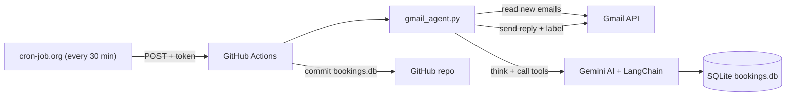

# Gmail AI Auto-Reply

An AI email agent that reads customer emails from Gmail, decides what to do with Google's Gemini AI and LangChain tools (check prices, check and book appointment slots), and sends a professional reply automatically. It runs **in the cloud every 30 minutes**, with no computer needed.

## How It Works



1. An external scheduler triggers the GitHub Actions workflow every 30 minutes
2. The agent fetches new emails from the Gmail **Primary** inbox
3. Newsletters, `noreply` senders and automated emails are skipped
4. Gemini AI reads the email and decides which tools to call (price, free slots, booking)
5. The reply is cleaned and sent, and the email gets an `AI-Processed` label
6. Updated bookings are saved back to the repository

## AI Agent (`gmail_agent.py`)

Built with **LangChain tool calling**. Instead of fixed `if/else` rules, the AI decides by itself which action to take.

**Tools available to the agent:**
- `get_price`: returns the real price of a plan
- `check_slot`: checks free booking slots in the database
- `book_slot`: books a slot (only after checking it is free)

**Example:** A customer emails *"I want to book a slot on Monday at 10am."* The agent calls `check_slot`, then `book_slot`, and replies with a confirmation, with no human involved.

**Safety features:**
- **Multi-step agent loop** with a `MAX_STEPS` limit to prevent infinite loops
- **No double booking**: an atomic SQL update (`UPDATE ... WHERE booked = 0` + `rowcount`) makes sure a slot can only be booked once
- **AI-based SKIP rule**: the agent replies `SKIP` to password resets, security alerts, receipts and other non-customer emails (defense in depth on top of the rule-based filters)
- **Gmail labels**: processed emails get an `AI-Processed` label, so the agent never replies twice
- **System prompt rules**: the agent only books when the customer clearly asks, and never guesses prices or slots

## Cloud Automation (GitHub Actions)

The agent runs on GitHub's servers through `.github/workflows/gmail_agent.yml`.

- **Secrets management**: `GEMINI_API_KEY` and `GMAIL_TOKEN_JSON` are stored as GitHub Secrets, never in the code
- **Test mode (`DRY_RUN`)**: a manual run has a "Test mode" checkbox; the agent does everything except send emails
- **Privacy-safe logs**: in the cloud, customer names and email text are not printed, because the repository is public
- **External scheduler**: GitHub's built-in `schedule` trigger proved unreliable, so [cron-job.org](https://cron-job.org) calls the `workflow_dispatch` REST API every 30 minutes, using a fine-grained token limited to this one repository and Actions only (least privilege)
- **Concurrency control**: only one run at a time, to avoid double bookings
- **Persistent state**: `bookings.db` is committed back to the repository after each live run

## Other Versions

- **`gmail_ai_reply.py`**: the first, rule-based version. It classifies emails (Booking, Pricing, Complaint, General), generates a reply with Gemini, retries on temporary errors (503), stops on quota errors (429), and stores processed IDs in SQLite
- **`app.py`**: a Flask API with a `/generate-reply` endpoint, deployed on PythonAnywhere

## Tech Stack

- Python 3
- Google Gmail API (OAuth 2.0)
- Google Gemini AI (`google-genai` SDK)
- LangChain (tool calling, agent loop)
- SQLite
- Flask
- GitHub Actions + cron-job.org (REST API, Bearer token)

## Setup (run locally)

1. Clone this repository
2. Install dependencies:
```
   pip install -r requirements.txt
```
3. Create a project in Google Cloud, enable the **Gmail API**, and download `credentials.json` into the project folder
4. Create a `.env` file:
```
   GEMINI_API_KEY=your_api_key_here
```
5. Test first, without sending emails (PowerShell):
```
   $env:DRY_RUN="true"
   python gmail_agent.py
```
   The first run opens a browser to log in to Gmail and creates `token.json`.

## Setup (cloud)

1. Add two repository secrets in **Settings → Secrets and variables → Actions**: `GEMINI_API_KEY` and `GMAIL_TOKEN_JSON` (the contents of `token.json`)
2. Run the workflow from the **Actions** tab with "Test mode" ticked, and check the logs
3. Create a fine-grained token (this repository only, **Actions: Read and write**) and set up a cron job that sends a `POST` request to:
```
   https://api.github.com/repos/<owner>/<repo>/actions/workflows/gmail_agent.yml/dispatches
```
   with the body `{"ref":"master","inputs":{"dry_run":"false"}}`

> Never commit `.env`, `token.json` or `credentials.json`. They are listed in `.gitignore`.

## Author

**Abdul Sattar Awan**: learning AI automation (Python, Gmail API, Gemini AI, LangChain, GitHub Actions)